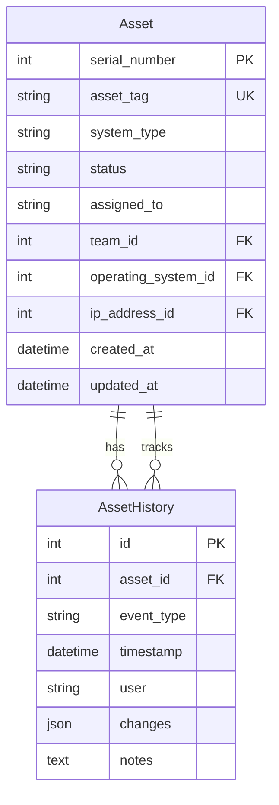

# Design Document: Asset History Tracking

## Overview

This feature extends the Django Asset Tracker to provide comprehensive audit trail capabilities for IT assets throughout their lifecycle. The design introduces an `AssetHistory` model that automatically records all changes to assets, including field modifications, status transitions, and user assignments. The system provides a timeline view for displaying history, filtering capabilities, and CSV export functionality.

The system will track asset creation, updates, status changes (active/freed/scrapped), reassignments, and health status modifications. History records are permanent and tamper-proof, maintaining accountability and supporting compliance requirements.

Key design principles:
- Automatic history recording through Django signals
- Permanent, immutable history records
- Efficient querying with pagination and indexing
- Human-readable display formatting
- Comprehensive user attribution

## Architecture

### Component Structure

```
assets/
├── models.py                    # Add AssetHistory model
├── services/
│   ├── asset_service.py        # Extend: Add history recording hooks
│   └── history_service.py      # New: History business logic
├── views.py                     # Add history views
├── templates/assets/
│   ├── asset_history.html      # New: History timeline view
│   ├── asset_detail.html       # Extend: Add history button
│   ├── asset_list.html         # Extend: Add history links
│   ├── freed_list.html         # Extend: Add history links
│   └── scrapped_list.html      # Extend: Add history links
└── urls.py                      # Add history routes
```

### Data Flow

1. **History Recording Flow**:
   - User performs asset operation (create/update/free/scrap/reassign)
   - AssetService method executes within transaction
   - Django post_save signal fires after asset save
   - Signal handler calls HistoryService.record_change()
   - HistoryService compares old and new values
   - System creates AssetHistory entry with changes
   - Transaction commits (asset + history atomically)

2. **History Display Flow**:
   - User clicks "View History" button/link
   - System queries AssetHistory filtered by asset
   - Pagination applied (50 entries per page)
   - Template formats entries with human-readable labels
   - User can apply filters (event type, date range, user)
   - Filtered results displayed in timeline format

3. **History Export Flow**:
   - User clicks "Export History" button
   - System queries filtered history entries
   - HistoryService generates CSV with all fields
   - Browser downloads CSV file
   - Filename includes asset tag and timestamp

## Components and Interfaces

### Models

#### AssetHistory Model

```python
class AssetHistory(models.Model):
    """Model for tracking all changes to assets."""
    
    EVENT_TYPE_CHOICES = [
        ('created', 'Created'),
        ('updated', 'Updated'),
        ('freed', 'Freed'),
        ('scrapped', 'Scrapped'),
        ('reassigned', 'Reassigned'),
        ('health_status_updated', 'Health Status Updated'),
    ]
    
    id = models.AutoField(primary_key=True)
    asset = models.ForeignKey(
        Asset,
        on_delete=models.CASCADE,
        related_name='history_entries',
        db_index=True,
        help_text="Asset this history entry belongs to"
    )
    event_type = models.CharField(
        max_length=30,
        choices=EVENT_TYPE_CHOICES,
        db_index=True,
        help_text="Type of event that occurred"
    )
    timestamp = models.DateTimeField(
        auto_now_add=True,
        db_index=True,
        help_text="When this change occurred"
    )
    user = models.CharField(
        max_length=150,
        db_index=True,
        help_text="Username of user who made the change"
    )
    changes = models.JSONField(
        default=dict,
        help_text="Dictionary of field changes: {field_name: {'old': value, 'new': value}}"
    )
    notes = models.TextField(
        blank=True,
        null=True,
        help_text="Additional context (e.g., scrapping reason)"
    )
    
    class Meta:
        ordering = ['-timestamp']
        verbose_name = 'Asset History'
        verbose_name_plural = 'Asset Histories'
        indexes = [
            models.Index(fields=['asset', '-timestamp']),
            models.Index(fields=['event_type', '-timestamp']),
            models.Index(fields=['user', '-timestamp']),
        ]
    
    def __str__(self):
        return f"{self.asset.asset_tag} - {self.event_type} at {self.timestamp}"
    
    def get_formatted_changes(self):
        """Return human-readable formatted changes."""
        from assets.services.history_service import HistoryService
        return HistoryService.format_changes_for_display(self.changes, self.asset)
```


### Services

#### HistoryService

```python
class HistoryService:
    """Business logic for asset history tracking."""
    
    # Fields to track in history
    TRACKED_FIELDS = [
        'asset_tag', 'system_type', 'operating_system', 'assigned_to',
        'team', 'status', 'ip_address', 'manual_ip', 'manufacturer',
        'hardware_serial_number', 'warranty_expiration', 'particulars',
        'health_status', 'issues_description', 'scrapping_reason'
    ]
    
    # Human-readable field labels
    FIELD_LABELS = {
        'asset_tag': 'Asset Tag',
        'system_type': 'System Type',
        'operating_system': 'Operating System',
        'assigned_to': 'Assigned To',
        'team': 'Team',
        'status': 'Status',
        'ip_address': 'IP Address',
        'manual_ip': 'Manual IP',
        'manufacturer': 'Manufacturer',
        'hardware_serial_number': 'Hardware Serial Number',
        'warranty_expiration': 'Warranty Expiration',
        'particulars': 'Particulars',
        'health_status': 'Health Status',
        'issues_description': 'Issues Description',
        'scrapping_reason': 'Scrapping Reason',
    }
    
    @staticmethod
    def record_creation(asset, user):
        """Record asset creation event."""
        changes = {}
        for field in HistoryService.TRACKED_FIELDS:
            value = HistoryService._get_field_value(asset, field)
            if value is not None and value != '':
                changes[field] = {'old': None, 'new': value}
        
        AssetHistory.objects.create(
            asset=asset,
            event_type='created',
            user=user.username,
            changes=changes
        )
    
    @staticmethod
    def record_update(asset, old_values, user):
        """Record asset update event."""
        changes = {}
        for field in HistoryService.TRACKED_FIELDS:
            old_value = old_values.get(field)
            new_value = HistoryService._get_field_value(asset, field)
            
            if old_value != new_value:
                changes[field] = {'old': old_value, 'new': new_value}
        
        if changes:
            AssetHistory.objects.create(
                asset=asset,
                event_type='updated',
                user=user.username,
                changes=changes
            )
    
    @staticmethod
    def record_status_change(asset, event_type, user, notes=None):
        """Record status transition event (freed, scrapped, reassigned)."""
        changes = {}
        
        # Record relevant field changes based on event type
        if event_type == 'freed':
            changes = {
                'status': {'old': 'active', 'new': 'freed'},
                'assigned_to': {'old': asset.assigned_to, 'new': None},
                'team': {'old': str(asset.team) if asset.team else None, 'new': None},
            }
        elif event_type == 'scrapped':
            changes = {
                'status': {'old': 'freed', 'new': 'scrapped'},
            }
        elif event_type == 'reassigned':
            changes = {
                'status': {'old': 'freed', 'new': 'active'},
            }
        
        AssetHistory.objects.create(
            asset=asset,
            event_type=event_type,
            user=user.username,
            changes=changes,
            notes=notes
        )
    
    @staticmethod
    def record_health_status_update(asset, old_health_status, user):
        """Record health status change for freed assets."""
        changes = {
            'health_status': {
                'old': old_health_status,
                'new': asset.health_status
            }
        }
        
        if asset.issues_description:
            changes['issues_description'] = {
                'old': None,
                'new': asset.issues_description
            }
        
        AssetHistory.objects.create(
            asset=asset,
            event_type='health_status_updated',
            user=user.username,
            changes=changes
        )
    
    @staticmethod
    def get_asset_history(asset, filters=None):
        """
        Get history entries for an asset with optional filtering.
        
        Args:
            asset: Asset instance
            filters: Dict with optional keys: event_type, user, date_from, date_to
        
        Returns:
            QuerySet: Filtered history entries
        """
        queryset = AssetHistory.objects.filter(asset=asset)
        
        if filters:
            if filters.get('event_type'):
                queryset = queryset.filter(event_type=filters['event_type'])
            if filters.get('user'):
                queryset = queryset.filter(user=filters['user'])
            if filters.get('date_from'):
                queryset = queryset.filter(timestamp__gte=filters['date_from'])
            if filters.get('date_to'):
                queryset = queryset.filter(timestamp__lte=filters['date_to'])
        
        return queryset.order_by('-timestamp')
    
    @staticmethod
    def export_history_to_csv(asset, filters=None):
        """
        Export asset history to CSV format.
        
        Args:
            asset: Asset instance
            filters: Optional filters dict
        
        Returns:
            HttpResponse: CSV file response
        """
        import csv
        from django.http import HttpResponse
        from django.utils import timezone
        
        response = HttpResponse(content_type='text/csv')
        filename = f'asset_history_{asset.asset_tag}_{timezone.now().strftime("%Y%m%d_%H%M%S")}.csv'
        response['Content-Disposition'] = f'attachment; filename="{filename}"'
        
        writer = csv.writer(response)
        writer.writerow(['Timestamp', 'Event Type', 'User', 'Field', 'Previous Value', 'New Value', 'Notes'])
        
        history_entries = HistoryService.get_asset_history(asset, filters)
        
        for entry in history_entries:
            if entry.changes:
                for field_name, values in entry.changes.items():
                    field_label = HistoryService.FIELD_LABELS.get(field_name, field_name)
                    old_value = HistoryService._format_value_for_export(values.get('old'))
                    new_value = HistoryService._format_value_for_export(values.get('new'))
                    
                    writer.writerow([
                        entry.timestamp.strftime('%Y-%m-%d %H:%M:%S'),
                        entry.get_event_type_display(),
                        entry.user,
                        field_label,
                        old_value,
                        new_value,
                        entry.notes or ''
                    ])
            else:
                writer.writerow([
                    entry.timestamp.strftime('%Y-%m-%d %H:%M:%S'),
                    entry.get_event_type_display(),
                    entry.user,
                    '',
                    '',
                    '',
                    entry.notes or ''
                ])
        
        return response
    
    @staticmethod
    def format_changes_for_display(changes, asset):
        """
        Format changes dictionary for human-readable display.
        
        Args:
            changes: Dict of field changes
            asset: Asset instance for context
        
        Returns:
            List of dicts with formatted change information
        """
        formatted = []
        
        for field_name, values in changes.items():
            field_label = HistoryService.FIELD_LABELS.get(field_name, field_name)
            old_value = HistoryService._format_value_for_display(values.get('old'), field_name, asset)
            new_value = HistoryService._format_value_for_display(values.get('new'), field_name, asset)
            
            formatted.append({
                'field': field_label,
                'old_value': old_value,
                'new_value': new_value
            })
        
        return formatted
    
    @staticmethod
    def _get_field_value(asset, field_name):
        """Get field value from asset, handling foreign keys."""
        value = getattr(asset, field_name, None)
        
        # Handle foreign key fields
        if field_name == 'operating_system' and value:
            return str(value)
        elif field_name == 'team' and value:
            return str(value)
        elif field_name == 'ip_address' and value:
            return value.address
        
        return value
    
    @staticmethod
    def _format_value_for_display(value, field_name, asset):
        """Format value for human-readable display."""
        if value is None or value == '':
            return 'Not set'
        
        # Format dates
        if field_name == 'warranty_expiration':
            from django.utils.dateformat import format
            return format(value, 'Y-m-d') if value else 'Not set'
        
        return str(value)
    
    @staticmethod
    def _format_value_for_export(value):
        """Format value for CSV export."""
        if value is None or value == '':
            return 'Not set'
        return str(value)
```

#### AssetService Extension

Extend existing AssetService methods to capture old values before updates:

```python
# Add to AssetService.update_asset method
@staticmethod
def update_asset(asset, data, user):
    """Update asset with IP change handling and history tracking."""
    with transaction.atomic():
        # Capture old values before update
        old_values = {}
        for field in HistoryService.TRACKED_FIELDS:
            old_values[field] = HistoryService._get_field_value(asset, field)
        
        # ... existing update logic ...
        
        asset.save()
        
        # Record history
        HistoryService.record_update(asset, old_values, user)
        
        return asset
```


### Views

#### AssetHistoryView

```python
class AssetHistoryView(LoginRequiredMixin, ListView):
    """Display asset history timeline."""
    model = AssetHistory
    template_name = 'assets/asset_history.html'
    context_object_name = 'history_entries'
    paginate_by = 50
    login_url = '/login/'
    
    def get_queryset(self):
        """Return filtered history entries for the asset."""
        asset_id = self.kwargs.get('pk')
        self.asset = get_object_or_404(Asset, pk=asset_id)
        
        filters = {}
        if self.request.GET.get('event_type'):
            filters['event_type'] = self.request.GET.get('event_type')
        if self.request.GET.get('user'):
            filters['user'] = self.request.GET.get('user')
        if self.request.GET.get('date_from'):
            filters['date_from'] = self.request.GET.get('date_from')
        if self.request.GET.get('date_to'):
            filters['date_to'] = self.request.GET.get('date_to')
        
        return HistoryService.get_asset_history(self.asset, filters)
    
    def get_context_data(self, **kwargs):
        context = super().get_context_data(**kwargs)
        context['asset'] = self.asset
        context['event_types'] = AssetHistory.EVENT_TYPE_CHOICES
        context['filters'] = {
            'event_type': self.request.GET.get('event_type', ''),
            'user': self.request.GET.get('user', ''),
            'date_from': self.request.GET.get('date_from', ''),
            'date_to': self.request.GET.get('date_to', ''),
        }
        return context
```


#### AssetHistoryExportView

```python
class AssetHistoryExportView(LoginRequiredMixin, View):
    """Export asset history to CSV."""
    login_url = '/login/'
    
    def get(self, request, pk):
        """Generate and return CSV file."""
        asset = get_object_or_404(Asset, pk=pk)
        
        filters = {}
        if request.GET.get('event_type'):
            filters['event_type'] = request.GET.get('event_type')
        if request.GET.get('user'):
            filters['user'] = request.GET.get('user')
        if request.GET.get('date_from'):
            filters['date_from'] = request.GET.get('date_from')
        if request.GET.get('date_to'):
            filters['date_to'] = request.GET.get('date_to')
        
        return HistoryService.export_history_to_csv(asset, filters)
```

### URL Configuration

```python
# Add to assets/urls.py
urlpatterns = [
    # ... existing patterns ...
    path('asset/<int:pk>/history/', AssetHistoryView.as_view(), name='asset_history'),
    path('asset/<int:pk>/history/export/', AssetHistoryExportView.as_view(), name='asset_history_export'),
]
```


## Data Models

### Entity Relationship Diagram



### Database Schema

#### AssetHistory Table

| Column | Type | Constraints | Description |
|--------|------|-------------|-------------|
| id | INTEGER | PRIMARY KEY, AUTO_INCREMENT | Unique identifier |
| asset_id | INTEGER | FOREIGN KEY (Asset), NOT NULL, INDEX | Asset reference |
| event_type | VARCHAR(30) | NOT NULL, INDEX | Event type (created/updated/freed/scrapped/reassigned/health_status_updated) |
| timestamp | DATETIME | NOT NULL, INDEX | When change occurred |
| user | VARCHAR(150) | NOT NULL, INDEX | Username who made change |
| changes | JSON | NOT NULL | Dictionary of field changes |
| notes | TEXT | NULL | Additional context |

**Indexes:**
- `idx_asset_history_asset_timestamp` on (asset_id, timestamp DESC)
- `idx_asset_history_event_timestamp` on (event_type, timestamp DESC)
- `idx_asset_history_user_timestamp` on (user, timestamp DESC)

**Foreign Keys:**
- `fk_asset_history_asset` FOREIGN KEY (asset_id) REFERENCES Asset(serial_number) ON DELETE CASCADE


### Data Validation Rules

1. **Asset Reference**: asset_id must reference an existing Asset
2. **Event Type**: Must be one of the defined EVENT_TYPE_CHOICES
3. **User**: Username must not be empty
4. **Timestamp**: Automatically set on creation, cannot be modified
5. **Changes JSON**: Must be valid JSON dictionary format
6. **Immutability**: History records cannot be updated or deleted through application interface

### Changes JSON Structure

```json
{
  "field_name": {
    "old": "previous_value",
    "new": "new_value"
  },
  "another_field": {
    "old": null,
    "new": "initial_value"
  }
}
```

Example for asset update:
```json
{
  "assigned_to": {
    "old": "John Doe",
    "new": "Jane Smith"
  },
  "team": {
    "old": "IT Support",
    "new": "Development"
  },
  "ip_address": {
    "old": "192.168.10.50",
    "new": "192.168.10.75"
  }
}
```


## Correctness Properties

*A property is a characteristic or behavior that should hold true across all valid executions of a system—essentially, a formal statement about what the system should do. Properties serve as the bridge between human-readable specifications and machine-verifiable correctness guarantees.*

### Property Reflection

After analyzing all acceptance criteria, I identified several areas of redundancy:

1. **Creation recording properties (1.1, 1.2, 1.3)** can be combined into a single property about creation event recording
2. **Field tracking properties (1.6, 2.6)** overlap and can be consolidated
3. **User attribution properties (4.1, 4.2, 8.1, 8.2, 8.3)** can be combined into comprehensive user tracking
4. **Display formatting properties (6.2, 6.3, 6.4, 6.5, 6.6)** can be consolidated
5. **Filter properties (9.1, 9.2, 9.3, 9.4)** can be combined into general filtering behavior
6. **Performance properties (11.1, 11.2, 11.3, 11.4)** can be consolidated

### Property 1: Creation Event Recording

*For any* asset created through any creation method (create_asset, create_freed_asset, create_scrapped_asset), the system should create a history entry with event_type matching the creation context, timestamp set to creation time, and initial field values recorded.

**Validates: Requirements 1.1, 1.2, 1.3, 1.4, 1.5, 1.6**

### Property 2: Field Update Recording

*For any* asset update that changes one or more tracked fields, the system should create a history entry with event_type='updated', recording both old and new values for all changed fields in a single entry.

**Validates: Requirements 2.1, 2.2, 2.3, 2.4, 2.5, 2.6**

### Property 3: Status Transition Recording

*For any* status transition (active→freed, freed→scrapped, freed→active), the system should create a history entry with the appropriate event_type, recording the status change and any related field changes (assignments, IPs).

**Validates: Requirements 3.1, 3.2, 3.3, 3.4, 3.5, 3.6, 3.7, 3.8, 3.9**


### Property 4: Health Status Change Recording

*For any* freed asset health status update, the system should create a history entry with event_type='health_status_updated', recording the health_status change and issues_description if applicable.

**Validates: Requirements 4.1, 4.2, 4.3, 4.4, 4.5, 4.6**

### Property 5: History Display Completeness

*For any* asset with history entries, viewing the history page should display all entries in reverse chronological order with event type, timestamp, and user visible for each entry.

**Validates: Requirements 5.1, 5.2, 5.3, 5.4, 5.5, 5.6, 5.7**

### Property 6: Human-Readable Formatting

*For any* history entry displayed, field names should use human-readable labels, timestamps should be formatted as date and time, null/empty values should display as "Not set", and foreign keys should show display names instead of IDs.

**Validates: Requirements 6.1, 6.2, 6.3, 6.4, 6.5, 6.6, 6.7**

### Property 7: History Immutability

*For any* history entry created, attempting to modify or delete it through the application interface should be prevented, and the entry should persist even if the related asset is deleted.

**Validates: Requirements 7.1, 7.2, 7.3, 7.4, 7.5**

### Property 8: User Attribution Completeness

*For any* history entry, the user field should contain the username of the user who performed the action, and this username should be preserved even if the user is later deleted from the system.

**Validates: Requirements 8.1, 8.2, 8.3, 8.4**

### Property 9: History Filtering

*For any* combination of filters (event type, date range, user), the history view should display only entries matching all active filters, and provide a clear filters option to reset.

**Validates: Requirements 9.1, 9.2, 9.3, 9.4, 9.5**


### Property 10: CSV Export Accuracy

*For any* asset history (with or without filters), exporting to CSV should generate a file containing all visible entries with columns for timestamp, event_type, user, field_name, previous_value, new_value, and notes.

**Validates: Requirements 10.1, 10.2, 10.3, 10.4, 10.5**

### Property 11: Query Performance

*For any* asset with fewer than 100 history entries, loading the history page should complete within 500ms, and for assets with more entries, pagination should display 50 entries per page with indexed queries.

**Validates: Requirements 11.1, 11.2, 11.3, 11.4, 11.5**

### Property 12: IP Address Change Tracking

*For any* IP address change (managed to manual, manual to managed, or IP to different IP), the history should record both the old and new IP values with appropriate formatting.

**Validates: Requirements 12.1, 12.2, 12.3, 12.4, 12.5**

### Property 13: Multi-Location Access

*For any* asset, the history view should be accessible from the asset detail page, active assets list, freed assets list, and scrapped assets list, all displaying the same complete history.

**Validates: Requirements 13.1, 13.2, 13.3, 13.4, 13.5**


## Error Handling

### Validation Errors

1. **Missing Asset Reference**
   - Error: "Asset reference is required"
   - HTTP Status: 400 Bad Request
   - System Action: Prevent history entry creation

2. **Invalid Event Type**
   - Error: "Invalid event type"
   - HTTP Status: 400 Bad Request
   - System Action: Reject history entry

3. **Missing User**
   - Error: "User information is required"
   - HTTP Status: 400 Bad Request
   - System Action: Prevent history entry creation

4. **Invalid JSON Format**
   - Error: "Changes data must be valid JSON"
   - HTTP Status: 400 Bad Request
   - System Action: Reject history entry

### Database Errors

1. **Transaction Failure**
   - Error: "Failed to record history. Please try again."
   - HTTP Status: 500 Internal Server Error
   - System Action: Rollback entire transaction (asset change + history)
   - User Action: Retry the operation

2. **Foreign Key Violation**
   - Error: "Referenced asset does not exist"
   - HTTP Status: 400 Bad Request
   - System Action: Prevent history entry creation

### Query Errors

1. **Asset Not Found**
   - Error: "Asset not found"
   - HTTP Status: 404 Not Found
   - User Action: Verify asset exists

2. **Invalid Filter Parameters**
   - Error: "Invalid filter parameters"
   - HTTP Status: 400 Bad Request
   - System Action: Ignore invalid filters, apply valid ones

### Export Errors

1. **Export Generation Failure**
   - Error: "Failed to generate export file"
   - HTTP Status: 500 Internal Server Error
   - System Action: Log error details
   - User Action: Retry export

### Error Handling Strategy

- All history recording happens within database transactions
- Failed history recording causes entire operation to rollback
- History queries use defensive programming (handle missing data gracefully)
- Export errors are logged but don't affect history display
- User-facing errors are clear and actionable
- Technical details logged for debugging


## Testing Strategy

### Dual Testing Approach

This feature requires both unit tests and property-based tests for comprehensive coverage:

**Unit Tests** focus on:
- Specific examples of history recording for each event type
- Edge cases (empty changes, null values, missing fields)
- Display formatting for specific field types
- Filter combinations with known data
- CSV export with sample history entries
- Template rendering with specific history data
- Permission checks for history access

**Property-Based Tests** focus on:
- Universal properties across all valid inputs
- History recording with randomized asset changes
- Filtering with random filter combinations
- Display formatting with random field values
- Export generation with random history datasets
- Query performance with varying history sizes
- Immutability guarantees across all operations

### Property-Based Testing Configuration

**Framework**: Hypothesis (Python property-based testing library)

**Configuration**:
- Minimum 100 iterations per property test
- Each test tagged with feature name and property reference
- Tag format: `# Feature: asset-history-tracking, Property {number}: {property_text}`

**Test Data Generators**:
```python
from hypothesis import strategies as st
from hypothesis.extra.django import from_model

# Asset change generator
@st.composite
def asset_changes(draw):
    """Generate random asset field changes."""
    fields = draw(st.lists(
        st.sampled_from(HistoryService.TRACKED_FIELDS),
        min_size=1,
        max_size=5,
        unique=True
    ))
    
    changes = {}
    for field in fields:
        old_value = draw(st.one_of(st.none(), st.text(max_size=100)))
        new_value = draw(st.text(max_size=100))
        changes[field] = {'old': old_value, 'new': new_value}
    
    return changes

# Event type generator
event_types = st.sampled_from([
    'created', 'updated', 'freed', 'scrapped', 'reassigned', 'health_status_updated'
])

# Filter generator
@st.composite
def history_filters(draw):
    """Generate random filter combinations."""
    return {
        'event_type': draw(st.one_of(st.none(), event_types)),
        'user': draw(st.one_of(st.none(), st.text(min_size=1, max_size=50))),
        'date_from': draw(st.one_of(st.none(), st.datetimes())),
        'date_to': draw(st.one_of(st.none(), st.datetimes())),
    }
```


### Property Test Examples

```python
from hypothesis import given, settings
from hypothesis import strategies as st
import pytest

# Feature: asset-history-tracking, Property 1: Creation Event Recording
@given(
    asset_tag=st.text(min_size=1, max_size=50),
    system_type=st.sampled_from(['Desktop', 'Laptop', 'All-in-One PC']),
    status=st.sampled_from(['active', 'freed', 'scrapped'])
)
@settings(max_examples=100)
def test_creation_event_recorded(asset_tag, system_type, status):
    """Property 1: Any asset creation should record history entry."""
    # Test implementation
    pass

# Feature: asset-history-tracking, Property 2: Field Update Recording
@given(changes=asset_changes())
@settings(max_examples=100)
def test_field_updates_recorded(changes):
    """Property 2: Any field update should record all changes in single entry."""
    # Test implementation
    pass

# Feature: asset-history-tracking, Property 9: History Filtering
@given(filters=history_filters())
@settings(max_examples=100)
def test_history_filtering(filters):
    """Property 9: Filtering should return only matching entries."""
    # Test implementation
    pass
```

### Unit Test Coverage

**Models:**
- AssetHistory model creation and validation
- Field choices and constraints
- String representation
- get_formatted_changes method

**Services:**
- HistoryService.record_creation with various asset types
- HistoryService.record_update with different field combinations
- HistoryService.record_status_change for each transition type
- HistoryService.record_health_status_update
- HistoryService.get_asset_history with various filters
- HistoryService.export_history_to_csv
- HistoryService.format_changes_for_display
- Field value extraction and formatting methods

**Views:**
- AssetHistoryView GET request
- AssetHistoryView with pagination
- AssetHistoryView with filters
- AssetHistoryExportView CSV generation
- Permission checks for authenticated users

**Templates:**
- History timeline rendering
- Filter form rendering
- Empty history state
- Pagination controls
- Export button presence


## Implementation Notes

### Integration Points

1. **AssetService Methods**
   - Modify all asset operation methods to call HistoryService
   - Capture old values before updates
   - Pass user context to history recording

2. **Database Migration**
   - Create AssetHistory table with indexes
   - No data migration needed (start fresh)
   - Add foreign key constraint with CASCADE delete

3. **Template Updates**
   - Add "View History" button to asset detail page
   - Add history icon/link to all asset list pages
   - Create new asset_history.html template
   - Style history timeline with Bootstrap

4. **URL Routing**
   - Add two new URL patterns for history view and export
   - Ensure proper permission checks

### Performance Considerations

1. **Database Indexes**
   - Composite index on (asset_id, timestamp DESC) for fast asset history queries
   - Index on event_type for filtering
   - Index on user for filtering
   - Index on timestamp for date range queries

2. **Query Optimization**
   - Use select_related for asset foreign keys
   - Implement pagination (50 entries per page)
   - Limit initial query to recent entries
   - Use database-level ordering

3. **JSON Field Usage**
   - Store changes as JSON for flexibility
   - Parse JSON only when displaying
   - Keep JSON structure simple and flat

4. **Caching Strategy**
   - No caching for history (always show latest)
   - Cache formatted field labels
   - Cache user list for filter dropdown

### Security Considerations

1. **Access Control**
   - Require authentication for all history views
   - Use LoginRequiredMixin on all views
   - No special permissions needed (all authenticated users can view)

2. **Data Integrity**
   - Use database transactions for atomicity
   - Prevent history modification through application
   - Use CASCADE delete to clean up history when asset deleted

3. **Input Validation**
   - Validate filter parameters
   - Sanitize user input in filters
   - Prevent SQL injection through ORM

### Migration Strategy

1. **Phase 1: Database Schema**
   - Create AssetHistory model
   - Run Django migration
   - Verify table creation and indexes

2. **Phase 2: Service Layer**
   - Implement HistoryService
   - Add history recording to AssetService methods
   - Test history recording in isolation

3. **Phase 3: Views and Templates**
   - Create history views
   - Create history template
   - Add history links to existing templates

4. **Phase 4: Testing**
   - Write unit tests
   - Write property-based tests
   - Perform integration testing

5. **Phase 5: Deployment**
   - Deploy to staging environment
   - Verify history recording works
   - Monitor performance
   - Deploy to production

