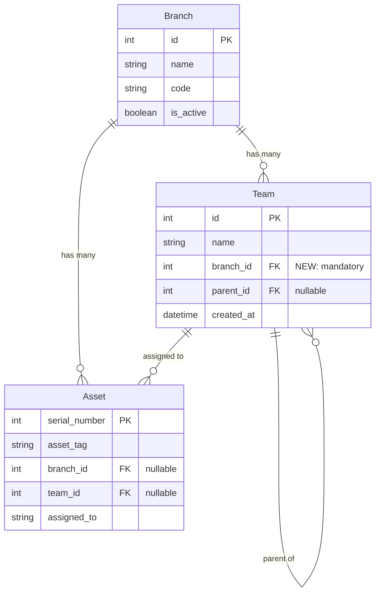

# Design Document: Branch-Specific Teams

## Overview

This design implements branch-specific teams in the Django Asset Tracker by adding a mandatory branch foreign key to the Team model. The implementation ensures that teams can only be assigned to assets within the same branch, preventing cross-branch team assignments while maintaining the existing hierarchical team structure (parent/sub-team relationships).

### Key Changes

1. **Team Model**: Add mandatory `branch` ForeignKey field
2. **Data Migration**: Assign all existing teams to Kochi branch
3. **Form Filtering**: Filter team dropdowns by selected/current branch
4. **Validation**: Prevent cross-branch team-asset assignments
5. **Admin Interface**: Display branch column and enable branch filtering
6. **Query Optimization**: Add database indexes and update query methods

### Design Goals

- Maintain backward compatibility with hierarchical team structure
- Ensure data integrity through validation
- Provide seamless migration for existing teams
- Optimize query performance with appropriate indexes
- Create intuitive UX with automatic team filtering

## Architecture

### Component Interaction Flow

```
User selects branch in AssetForm
    ↓
Form filters parent_team dropdown (teams.filter(branch=selected_branch, parent=None))
    ↓
User selects parent_team
    ↓
Form filters sub_team dropdown (parent.sub_teams.filter(branch=selected_branch))
    ↓
User selects sub_team (or leaves parent_team only)
    ↓
Form validation checks: asset.team.branch == asset.branch
    ↓
Save asset with valid team assignment
```

### Data Relationship Diagram



### Validation Flow

```mermaid
flowchart TD
    A[Asset.save() called] --> B{team assigned?}
    B -->|No| Z[Save succeeds]
    B -->|Yes| C{branch assigned?}
    C -->|No| D[ValidationError: Asset must have a branch]
    C -->|Yes| E{team.branch == asset.branch?}
    E -->|No| F[ValidationError: Team must belong to same branch]
    E -->|Yes| G{team has parent?}
    G -->|No| Z
    G -->|Yes| H{parent.branch == team.branch?}
    H -->|No| I[ValidationError: Sub-team branch mismatch]
    H -->|Yes| Z
```

## Components and Interfaces

### 1. Team Model Updates

**File**: `assets/models.py`

**Changes**:

```python
class Team(models.Model):
    """Model for storing organizational teams with hierarchical support."""
    name = models.CharField(max_length=100, unique=True)
    
    # NEW: Mandatory branch association
    branch = models.ForeignKey(
        Branch,
        on_delete=models.PROTECT,
        related_name='teams',
        db_index=True,
        help_text="Branch this team belongs to"
    )
    
    parent = models.ForeignKey(
        'self',
        on_delete=models.CASCADE,
        null=True,
        blank=True,
        related_name='sub_teams',
        db_index=True
    )
    created_at = models.DateTimeField(auto_now_add=True)

    objects = TeamManager()

    class Meta:
        ordering = ['branch__name', 'name']
        indexes = [
            models.Index(fields=['branch', 'parent', 'name']),
            models.Index(fields=['parent', 'name']),
        ]
        # Unique constraint: team name must be unique within a branch
        constraints = [
            models.UniqueConstraint(
                fields=['branch', 'name'],
                name='unique_team_name_per_branch'
            )
        ]

    def clean(self):
        """Validate team hierarchy and branch constraints."""
        super().clean()
        
        # Prevent self-reference
        if self.parent == self:
            raise ValidationError("A team cannot be its own parent.")

        # Prevent circular references
        if self.parent and self._creates_circular_reference():
            raise ValidationError("This parent assignment would create a circular reference.")

        # Prevent depth > 2 (only parent and sub-team levels)
        if self.parent and self.parent.parent:
            raise ValidationError("Teams can only be nested 2 levels deep (parent and sub-team).")

        # Prevent converting parent with children to sub-team
        if self.parent and self.sub_teams.exists():
            raise ValidationError("Cannot assign a parent to a team that has sub-teams.")
        
        # NEW: Validate branch consistency with parent
        if self.parent and self.branch_id != self.parent.branch_id:
            raise ValidationError(
                "Sub-team must belong to the same branch as its parent team."
            )
        
        # NEW: Prevent changing branch if team has sub-teams
        if self.pk and self.sub_teams.exists():
            old_instance = Team.objects.get(pk=self.pk)
            if old_instance.branch_id != self.branch_id:
                raise ValidationError(
                    "Cannot change branch - this parent team has sub-teams in the current branch."
                )
```

### 2. TeamManager Updates

**File**: `assets/models.py`

**Changes**:

```python
class TeamManager(models.Manager):
    """Custom manager for efficient team hierarchy queries."""
    
    def get_hierarchy(self, branch=None):
        """
        Get all teams with parent relationships prefetched.
        
        Args:
            branch: Optional Branch instance to filter by
        """
        qs = self.select_related('parent', 'branch').prefetch_related('sub_teams')
        if branch:
            qs = qs.filter(branch=branch)
        return qs
    
    def get_parent_teams(self, branch=None):
        """
        Get only parent teams (teams without a parent).
        
        Args:
            branch: Optional Branch instance to filter by
        """
        qs = self.filter(parent__isnull=True)
        if branch:
            qs = qs.filter(branch=branch)
        return qs
    
    def get_sub_teams(self, branch=None):
        """
        Get only sub-teams (teams with a parent).
        
        Args:
            branch: Optional Branch instance to filter by
        """
        qs = self.filter(parent__isnull=False)
        if branch:
            qs = qs.filter(branch=branch)
        return qs
    
    def get_teams_by_branch(self, branch):
        """
        Get all teams for a specific branch.
        
        Args:
            branch: Branch instance
            
        Returns:
            QuerySet of teams for the branch, ordered hierarchically
        """
        return self.filter(branch=branch).select_related('parent', 'branch').order_by('parent__name', 'name')
    
    def get_hierarchical_choices(self, branch=None):
        """
        Get teams formatted for dropdown display with hierarchy.
        
        Args:
            branch: Optional Branch instance to filter by
            
        Returns:
            list of tuples: (id, display_name)
        """
        choices = []
        parent_teams = self.get_parent_teams(branch=branch).order_by('name')
        
        for parent in parent_teams:
            choices.append((parent.id, parent.name))
            sub_teams = parent.sub_teams.filter(branch=parent.branch).order_by('name') if branch else parent.sub_teams.all().order_by('name')
            for sub in sub_teams:
                choices.append((sub.id, f"  └─ {sub.name}"))
        
        return choices
```

### 3. Asset Model Validation

**File**: `assets/models.py`

**Changes**:

```python
class Asset(models.Model):
    # ... existing fields ...
    
    def clean(self):
        """Validate asset data including branch-team consistency."""
        super().clean()
        
        # Existing validation ...
        
        # NEW: Validate team belongs to same branch as asset
        if self.team and self.branch:
            if self.team.branch_id != self.branch_id:
                raise ValidationError({
                    'team': 'Team must belong to the same branch as the asset.'
                })
        
        # NEW: Require branch if team is assigned
        if self.team and not self.branch:
            raise ValidationError({
                'branch': 'Asset must have a branch when a team is assigned.'
            })
```

### 4. AssetForm Updates

**File**: `assets/forms/asset_forms.py`

**Changes**:

```python
class AssetForm(forms.ModelForm):
    """Form for creating and updating assets."""
    
    parent_team = forms.ModelChoiceField(
        queryset=Team.objects.none(),  # Will be populated in __init__
        required=False,
        empty_label="Select Team",
        widget=forms.Select(attrs={
            'class': 'form-control',
            'id': 'id_parent_team',
            'onchange': 'handleParentTeamChange(this.value)'
        }),
        label='Team'
    )
    
    sub_team = forms.ModelChoiceField(
        queryset=Team.objects.none(),
        required=False,
        empty_label="Select Sub-Team",
        widget=forms.Select(attrs={
            'class': 'form-control',
            'id': 'id_sub_team',
            'style': 'display:none;'
        }),
        label='Sub-Team'
    )
    
    # ... existing Meta and fields ...
    
    def __init__(self, *args, **kwargs):
        super().__init__(*args, **kwargs)
        
        # Populate branch dropdown
        from assets.models import Branch
        self.fields['branch'].queryset = Branch.objects.filter(is_active=True)
        self.fields['branch'].empty_label = "Select Branch"
        self.fields['branch'].required = True
        
        # Add branch change handler to branch widget
        self.fields['branch'].widget.attrs.update({
            'onchange': 'handleBranchChange(this.value)'
        })
        
        # Filter teams by branch
        current_branch = None
        
        # For editing existing assets
        if self.instance and self.instance.pk:
            current_branch = self.instance.branch
            
            # Set up team dropdowns based on current team
            if self.instance.team:
                current_team = self.instance.team
                if current_team.parent:
                    # Asset is assigned to a sub-team
                    self.fields['parent_team'].queryset = Team.objects.get_parent_teams(branch=current_branch)
                    self.fields['parent_team'].initial = current_team.parent
                    self.fields['sub_team'].queryset = current_team.parent.sub_teams.filter(branch=current_branch)
                    self.fields['sub_team'].initial = current_team
                    self.fields['sub_team'].widget.attrs['style'] = ''
                else:
                    # Asset is assigned to a parent team
                    self.fields['parent_team'].queryset = Team.objects.get_parent_teams(branch=current_branch)
                    self.fields['parent_team'].initial = current_team
                self.fields['team'].initial = current_team
        
        # For form submission with POST data
        if self.data:
            try:
                branch_id = self.data.get('branch')
                if branch_id:
                    current_branch = Branch.objects.get(pk=branch_id)
                    self.fields['parent_team'].queryset = Team.objects.get_parent_teams(branch=current_branch)
                    
                    parent_team_id = self.data.get('parent_team')
                    if parent_team_id:
                        parent_team = Team.objects.get(pk=parent_team_id)
                        # Ensure parent team belongs to selected branch
                        if parent_team.branch_id == current_branch.id:
                            self.fields['sub_team'].queryset = parent_team.sub_teams.filter(branch=current_branch)
            except (ValueError, Branch.DoesNotExist, Team.DoesNotExist):
                pass
        
        # Set empty queryset if no branch selected
        if not current_branch and not self.data.get('branch'):
            self.fields['parent_team'].queryset = Team.objects.none()
            self.fields['sub_team'].queryset = Team.objects.none()
        
        # ... rest of existing __init__ code ...
```

### 5. ReassignmentForm Updates

**File**: `assets/forms/asset_forms.py`

**Changes**:

```python
class ReassignmentForm(forms.Form):
    """Form for reassigning freed systems back to active status."""
    
    # ... existing fields ...
    
    def __init__(self, *args, **kwargs):
        asset = kwargs.pop('asset', None)
        super().__init__(*args, **kwargs)
        
        # NEW: Filter teams by asset's branch
        asset_branch = asset.branch if asset else None
        
        if asset_branch:
            self.fields['parent_team'].queryset = Team.objects.get_parent_teams(branch=asset_branch)
        else:
            self.fields['parent_team'].queryset = Team.objects.none()
        
        # Handle team cascading dropdown - for form submission with POST data
        if self.data:
            try:
                parent_team_id = self.data.get('parent_team')
                if parent_team_id and asset_branch:
                    parent_team = Team.objects.get(pk=parent_team_id)
                    # Ensure parent team belongs to asset's branch
                    if parent_team.branch_id == asset_branch.id:
                        self.fields['sub_team'].queryset = parent_team.sub_teams.filter(branch=asset_branch)
            except (ValueError, Team.DoesNotExist):
                pass
        
        # Pre-populate fields with current asset values if asset provided
        if asset:
            # ... existing pre-population code ...
            
            if asset.team and asset_branch:
                if asset.team.parent:
                    self.fields['parent_team'].initial = asset.team.parent
                    self.fields['sub_team'].queryset = asset.team.parent.sub_teams.filter(branch=asset_branch)
                    self.fields['sub_team'].initial = asset.team
                    self.fields['sub_team'].widget.attrs['style'] = ''
                else:
                    self.fields['parent_team'].initial = asset.team
                self.fields['team'].initial = asset.team
    
    def clean(self):
        """Cross-field validation."""
        cleaned_data = super().clean()
        parent_team = cleaned_data.get('parent_team')
        sub_team = cleaned_data.get('sub_team')
        
        # Determine which team to assign
        if sub_team:
            cleaned_data['team'] = sub_team
        elif parent_team:
            cleaned_data['team'] = parent_team
        else:
            raise forms.ValidationError("Please select a team.")
        
        return cleaned_data
```

### 6. JavaScript for Branch-Team Coordination

**File**: `assets/templates/assets/asset_form.html` (or shared JS file)

**New JavaScript**:

```javascript
function handleBranchChange(branchId) {
    // Clear team selections when branch changes
    document.getElementById('id_parent_team').value = '';
    document.getElementById('id_sub_team').value = '';
    document.getElementById('id_sub_team').style.display = 'none';
    document.getElementById('id_team').value = '';
    
    if (branchId) {
        // Reload parent team dropdown via AJAX
        fetch(`/api/teams/parent-teams/?branch=${branchId}`)
            .then(response => response.json())
            .then(data => {
                const parentTeamSelect = document.getElementById('id_parent_team');
                parentTeamSelect.innerHTML = '<option value="">Select Team</option>';
                data.teams.forEach(team => {
                    const option = document.createElement('option');
                    option.value = team.id;
                    option.textContent = team.name;
                    parentTeamSelect.appendChild(option);
                });
            });
    }
}

function handleParentTeamChange(parentTeamId) {
    const subTeamDiv = document.getElementById('id_sub_team');
    const branchId = document.getElementById('id_branch').value;
    
    if (parentTeamId && branchId) {
        // Load sub-teams filtered by both parent and branch
        fetch(`/api/teams/sub-teams/?parent=${parentTeamId}&branch=${branchId}`)
            .then(response => response.json())
            .then(data => {
                if (data.sub_teams.length > 0) {
                    subTeamDiv.innerHTML = '<option value="">Select Sub-Team</option>';
                    data.sub_teams.forEach(team => {
                        const option = document.createElement('option');
                        option.value = team.id;
                        option.textContent = `  └─ ${team.name}`;
                        subTeamDiv.appendChild(option);
                    });
                    subTeamDiv.style.display = '';
                } else {
                    subTeamDiv.style.display = 'none';
                }
                document.getElementById('id_team').value = parentTeamId;
            });
    } else {
        subTeamDiv.style.display = 'none';
        document.getElementById('id_team').value = parentTeamId || '';
    }
}
```

### 7. API Endpoints for Team Filtering

**File**: `assets/views.py` or `assets/api/views.py`

**New endpoints**:

```python
from django.http import JsonResponse
from django.views.decorators.http import require_GET
from assets.models import Team, Branch

@require_GET
def get_parent_teams_by_branch(request):
    """API endpoint to get parent teams filtered by branch."""
    branch_id = request.GET.get('branch')
    
    if not branch_id:
        return JsonResponse({'teams': []})
    
    try:
        branch = Branch.objects.get(pk=branch_id)
        teams = Team.objects.get_parent_teams(branch=branch).values('id', 'name')
        return JsonResponse({'teams': list(teams)})
    except Branch.DoesNotExist:
        return JsonResponse({'teams': []})

@require_GET
def get_sub_teams_by_parent_and_branch(request):
    """API endpoint to get sub-teams filtered by parent and branch."""
    parent_id = request.GET.get('parent')
    branch_id = request.GET.get('branch')
    
    if not parent_id or not branch_id:
        return JsonResponse({'sub_teams': []})
    
    try:
        parent = Team.objects.get(pk=parent_id)
        branch = Branch.objects.get(pk=branch_id)
        
        # Verify parent belongs to the branch
        if parent.branch_id != branch.id:
            return JsonResponse({'sub_teams': []})
        
        sub_teams = parent.sub_teams.filter(branch=branch).values('id', 'name')
        return JsonResponse({'sub_teams': list(sub_teams)})
    except (Team.DoesNotExist, Branch.DoesNotExist):
        return JsonResponse({'sub_teams': []})
```

### 8. Django Admin Configuration

**File**: `assets/admin.py`

**Changes**:

```python
from django.contrib import admin
from assets.models import Team

@admin.register(Team)
class TeamAdmin(admin.ModelAdmin):
    list_display = ['name', 'branch', 'parent', 'hierarchy_level', 'created_at']
    list_filter = ['branch', 'parent']
    search_fields = ['name', 'branch__name']
    ordering = ['branch__name', 'parent__name', 'name']
    
    fieldsets = (
        (None, {
            'fields': ('name', 'branch', 'parent')
        }),
        ('Metadata', {
            'fields': ('created_at',),
            'classes': ('collapse',)
        }),
    )
    
    readonly_fields = ['created_at']
    
    def get_queryset(self, request):
        """Optimize queries with select_related."""
        return super().get_queryset(request).select_related('branch', 'parent')
```

## Data Models

### Team Model Schema

```python
class Team(models.Model):
    id = AutoField(primary_key=True)
    name = CharField(max_length=100)
    branch = ForeignKey(Branch, on_delete=PROTECT)  # NEW
    parent = ForeignKey('self', null=True, blank=True, on_delete=CASCADE)
    created_at = DateTimeField(auto_now_add=True)
    
    class Meta:
        constraints = [
            UniqueConstraint(fields=['branch', 'name'], name='unique_team_name_per_branch')
        ]
        indexes = [
            Index(fields=['branch', 'parent', 'name']),
            Index(fields=['parent', 'name']),
        ]
```

### Migration Strategy

**File**: `assets/migrations/XXXX_add_branch_to_team.py`

```python
from django.db import migrations, models
import django.db.models.deletion

def assign_teams_to_kochi_branch(apps, schema_editor):
    """Assign all existing teams to Kochi branch."""
    Team = apps.get_model('assets', 'Team')
    Branch = apps.get_model('assets', 'Branch')
    
    # Get or create Kochi branch
    kochi_branch, created = Branch.objects.get_or_create(
        name='Kochi',
        defaults={'code': 'KCH', 'is_active': True}
    )
    
    if created:
        print(f"Created Kochi branch with code KCH")
    
    # Assign all teams to Kochi branch
    team_count = Team.objects.update(branch=kochi_branch)
    print(f"Assigned {team_count} teams to Kochi branch")
    
    # Validation: check for any cross-branch asset-team assignments
    Asset = apps.get_model('assets', 'Asset')
    inconsistent_assets = Asset.objects.filter(
        team__isnull=False,
        branch__isnull=False
    ).exclude(
        team__branch=models.F('branch')
    )
    
    inconsistent_count = inconsistent_assets.count()
    if inconsistent_count > 0:
        print(f"WARNING: Found {inconsistent_count} assets with cross-branch team assignments")
        for asset in inconsistent_assets[:10]:  # Show first 10
            print(f"  Asset {asset.asset_tag}: branch={asset.branch.name}, team.branch={asset.team.branch.name}")

def reverse_branch_assignment(apps, schema_editor):
    """Reverse migration - remove branch assignments."""
    # Branch field will be removed by schema migration
    # No data migration needed for reverse
    pass

class Migration(migrations.Migration):

    dependencies = [
        ('assets', 'XXXX_previous_migration'),
    ]

    operations = [
        # Add branch field as nullable first
        migrations.AddField(
            model_name='team',
            name='branch',
            field=models.ForeignKey(
                null=True,
                on_delete=django.db.models.deletion.PROTECT,
                related_name='teams',
                to='assets.branch'
            ),
        ),
        
        # Assign all teams to Kochi branch
        migrations.RunPython(
            assign_teams_to_kochi_branch,
            reverse_branch_assignment
        ),
        
        # Make branch field non-nullable
        migrations.AlterField(
            model_name='team',
            name='branch',
            field=models.ForeignKey(
                on_delete=django.db.models.deletion.PROTECT,
                related_name='teams',
                to='assets.branch',
                help_text='Branch this team belongs to'
            ),
        ),
        
        # Add database index
        migrations.AddIndex(
            model_name='team',
            index=models.Index(fields=['branch', 'parent', 'name'], name='team_branch_parent_name_idx'),
        ),
        
        # Add unique constraint
        migrations.AddConstraint(
            model_name='team',
            constraint=models.UniqueConstraint(
                fields=['branch', 'name'],
                name='unique_team_name_per_branch'
            ),
        ),
        
        # Update Meta ordering
        migrations.AlterModelOptions(
            name='team',
            options={'ordering': ['branch__name', 'name']},
        ),
    ]
```

## Error Handling

### Validation Errors

1. **Cross-Branch Team Assignment**
   - **Trigger**: Asset.team.branch != Asset.branch
   - **Error**: `ValidationError("Team must belong to the same branch as the asset.")`
   - **Display**: Form field error on 'team' field
   - **Recovery**: User must select team from asset's branch

2. **Sub-Team Branch Mismatch**
   - **Trigger**: Team.parent.branch != Team.branch
   - **Error**: `ValidationError("Sub-team must belong to the same branch as its parent team.")`
   - **Display**: Form field error on 'branch' field
   - **Recovery**: User must select same branch as parent or choose different parent

3. **Parent Branch Change with Sub-Teams**
   - **Trigger**: Team with sub_teams tries to change branch
   - **Error**: `ValidationError("Cannot change branch - this parent team has sub-teams in the current branch.")`
   - **Display**: Form field error on 'branch' field
   - **Recovery**: User must reassign or delete sub-teams first

4. **Missing Branch with Team**
   - **Trigger**: Asset.team is set but Asset.branch is None
   - **Error**: `ValidationError("Asset must have a branch when a team is assigned.")`
   - **Display**: Form field error on 'branch' field
   - **Recovery**: User must select branch

### Migration Error Handling

```python
def assign_teams_to_kochi_branch(apps, schema_editor):
    """Assign all existing teams to Kochi branch with error handling."""
    try:
        Team = apps.get_model('assets', 'Team')
        Branch = apps.get_model('assets', 'Branch')
        
        # Use database transaction
        with schema_editor.connection.cursor() as cursor:
            # Get or create Kochi branch
            kochi_branch, created = Branch.objects.get_or_create(
                name='Kochi',
                defaults={'code': 'KCH', 'is_active': True}
            )
            
            # Assign all teams to Kochi branch
            team_count = Team.objects.update(branch=kochi_branch)
            
            print(f"Successfully assigned {team_count} teams to Kochi branch")
            
    except Exception as e:
        print(f"ERROR during team migration: {e}")
        raise  # Re-raise to trigger rollback
```

## Testing Strategy

This feature includes both unit tests for specific behaviors and property-based tests for comprehensive validation of universal correctness properties.

### Unit Tests

Unit tests validate specific scenarios, edge cases, and integration points:

1. **Migration Tests**
   - Test Kochi branch creation if not exists
   - Test Kochi branch reuse if exists
   - Test all teams assigned to Kochi
   - Test migration rollback

2. **Model Validation Tests**
   - Test branch field is required
   - Test team.clean() validates sub-team branch matches parent
   - Test team.clean() prevents parent branch change with sub-teams
   - Test asset.clean() validates team.branch == asset.branch

3. **Form Tests**
   - Test AssetForm filters teams by selected branch
   - Test AssetForm clears team selection when branch changes
   - Test ReassignmentForm filters teams by asset.branch
   - Test form validation prevents cross-branch assignments

4. **Admin Tests**
   - Test team admin displays branch column
   - Test team admin filters by branch
   - Test team admin form validates branch constraints

5. **API Tests**
   - Test get_parent_teams_by_branch endpoint
   - Test get_sub_teams_by_parent_and_branch endpoint
   - Test endpoints return empty list for invalid branch

### Property-Based Testing

This feature is well-suited for property-based testing because:
- Branch-team relationships follow universal rules across all branches
- Team assignments must satisfy invariants regardless of input data
- Form filtering behavior should be consistent for any branch
- Validation rules apply universally to all team-asset combinations

We will use **Hypothesis** with the Django integration (`hypothesis.extra.django`) for property-based testing.

**Property-based tests will run with minimum 100 iterations** to ensure comprehensive coverage across randomized inputs.

#### Test Configuration

```python
from hypothesis import given, strategies as st, settings
from hypothesis.extra.django import TestCase
from assets.models import Branch, Team, Asset

# Minimum 100 iterations per property test
DEFAULT_SETTINGS = settings(max_examples=100)
```

## Correctness Properties

*A property is a characteristic or behavior that should hold true across all valid executions of a system—essentially, a formal statement about what the system should do. Properties serve as the bridge between human-readable specifications and machine-verifiable correctness guarantees.*

### Property Reflection

After analyzing all acceptance criteria, I identified the following properties that should be tested. Some criteria were redundant and have been consolidated:

**Redundancies eliminated:**
- Requirements 3.1, 3.2, and 3.5 all test the same filtering behavior (teams filtered by branch)
- Requirements 4.1 and 4.2 are identical (team.branch must equal asset.branch)
- Requirements 6.1 and 6.2 both test get_teams_by_branch filtering
- Team dropdown filtering (3.1, 3.2, 3.5) consolidated into a single property about queryset filtering

**Properties retained:**
Each remaining property provides unique validation value for branch-team consistency, filtering behavior, or data integrity.

### Property 1: Branch Field is Mandatory

*For any* team creation attempt without a branch field, the system SHALL raise a ValidationError or IntegrityError.

**Validates: Requirements 1.2, 1.3**

### Property 2: Team Display Includes Branch

*For any* team with an assigned branch, the string representation or display method SHALL include the branch name or identifier.

**Validates: Requirements 1.4**

### Property 3: Hierarchical Relationships Preserved

*For any* valid parent-child team pair with branches assigned, the parent relationship SHALL be maintained and queryable through team.parent and parent.sub_teams.

**Validates: Requirements 1.5**

### Property 4: Branch Deletion Protection

*For any* branch that has teams assigned to it, attempting to delete the branch SHALL raise a ProtectedError.

**Validates: Requirements 1.6**

### Property 5: Migration Preserves Team Data

*For any* set of teams before migration, after migration all teams SHALL have identical values for name, parent, and created_at fields (only branch field added).

**Validates: Requirements 2.4**

### Property 6: Migration Transaction Atomicity

*For any* migration execution that encounters an error, the database state SHALL be identical to the pre-migration state (all changes rolled back).

**Validates: Requirements 2.6**

### Property 7: Migration Logging Completeness

*For any* number of teams N in the database, after running the migration, the migration log SHALL contain the count N.

**Validates: Requirements 2.7**

### Property 8: Team Dropdown Filtered by Branch

*For any* asset form with a selected branch, the team queryset (parent_team and sub_team) SHALL contain only teams where team.branch equals the selected branch.

**Validates: Requirements 3.1, 3.2, 3.5, 3.7**

### Property 9: Empty Team Dropdown Without Branch

*For any* form state where no branch is selected, the team queryset SHALL be empty.

**Validates: Requirements 3.3**

### Property 10: Hierarchical Display Maintained

*For any* branch with both parent teams and sub-teams, the dropdown display SHALL show sub-teams visually indented or marked as children of their parents.

**Validates: Requirements 3.4**

### Property 11: Cross-Branch Assignment Validation

*For any* asset with both team and branch assigned, if team.branch != asset.branch, the asset.clean() method SHALL raise a ValidationError.

**Validates: Requirements 4.1, 4.2**

### Property 12: Validation Error Message Content

*For any* asset with mismatched team and branch, the ValidationError message SHALL contain the text "Team must belong to the same branch as the asset".

**Validates: Requirements 4.3**

### Property 13: Validation Before Database Save

*For any* invalid asset (mismatched team/branch), calling asset.save() SHALL raise a validation error before any database write operation occurs.

**Validates: Requirements 4.5**

### Property 14: Validation for New and Existing Assets

*For any* asset (new or existing), the branch-team validation SHALL apply equally, raising ValidationError for mismatches in both cases.

**Validates: Requirements 4.6**

### Property 15: Validation Passes Without Team

*For any* asset without a team assigned (team=None), the validation SHALL succeed regardless of branch value.

**Validates: Requirements 4.7**

### Property 16: TeamManager Branch Filtering

*For any* branch, calling TeamManager.get_teams_by_branch(branch) SHALL return exactly the teams where team.branch equals the provided branch.

**Validates: Requirements 6.1, 6.2**

### Property 17: Hierarchical Ordering in Branch Queries

*For any* branch with parent teams and sub-teams, get_teams_by_branch(branch) SHALL return teams ordered with parents before their sub-teams.

**Validates: Requirements 6.3**

### Property 18: Optional Branch Parameter in Manager Methods

*For any* TeamManager query method (get_parent_teams, get_sub_teams, get_hierarchical_choices), when called with a branch parameter, the results SHALL only include teams from that branch.

**Validates: Requirements 6.4, 6.5, 6.6**

### Property 19: Sub-Team Branch Matches Parent

*For any* team with a parent, if the team.branch != parent.branch, the team.clean() method SHALL raise a ValidationError with message "Sub-team must belong to the same branch as its parent team".

**Validates: Requirements 11.1, 11.2, 11.3**

### Property 20: Parent Branch Change Prevention

*For any* parent team with existing sub-teams, attempting to change the parent's branch SHALL raise a ValidationError with message "Cannot change branch - this parent team has sub-teams in the current branch".

**Validates: Requirements 11.5, 11.6**


## Implementation Notes

### Property-Based Test Examples

Here are example implementations for key properties:

```python
# Property 11: Cross-Branch Assignment Validation
@given(
    branch1=st.builds(Branch.objects.create, name=st.text(min_size=1, max_size=50), code=st.text(min_size=3, max_size=10)),
    branch2=st.builds(Branch.objects.create, name=st.text(min_size=1, max_size=50), code=st.text(min_size=3, max_size=10)),
    team_name=st.text(min_size=1, max_size=100),
    asset_tag=st.text(min_size=1, max_size=50)
)
@settings(max_examples=100)
def test_cross_branch_assignment_raises_error(self, branch1, branch2, team_name, asset_tag):
    """
    Feature: branch-specific-teams, Property 11: Cross-Branch Assignment Validation
    For any asset with both team and branch assigned, if team.branch != asset.branch,
    the asset.clean() method SHALL raise a ValidationError.
    """
    # Create team in branch1
    team = Team.objects.create(name=team_name, branch=branch1)
    
    # Create asset in branch2 assigned to team from branch1
    asset = Asset(
        asset_tag=asset_tag,
        system_type='Desktop',
        branch=branch2,
        team=team
    )
    
    # Validation should fail
    with pytest.raises(ValidationError) as exc_info:
        asset.clean()
    
    assert 'team' in exc_info.value.message_dict


# Property 8: Team Dropdown Filtered by Branch
@given(
    branch_name=st.text(min_size=1, max_size=50),
    num_teams_in_branch=st.integers(min_value=1, max_value=10),
    num_teams_other_branch=st.integers(min_value=1, max_value=10)
)
@settings(max_examples=100)
def test_team_dropdown_filtered_by_branch(self, branch_name, num_teams_in_branch, num_teams_other_branch):
    """
    Feature: branch-specific-teams, Property 8: Team Dropdown Filtered by Branch
    For any asset form with a selected branch, the team queryset SHALL contain only
    teams where team.branch equals the selected branch.
    """
    # Create target branch and other branch
    target_branch = Branch.objects.create(name=branch_name, code='TGT')
    other_branch = Branch.objects.create(name=f"Other_{branch_name}", code='OTH')
    
    # Create teams in target branch
    for i in range(num_teams_in_branch):
        Team.objects.create(name=f"Team_{branch_name}_{i}", branch=target_branch)
    
    # Create teams in other branch
    for i in range(num_teams_other_branch):
        Team.objects.create(name=f"Team_Other_{i}", branch=other_branch)
    
    # Create form with asset having target_branch
    asset = Asset(branch=target_branch, system_type='Desktop', asset_tag='TEST001')
    asset.save()
    
    form = AssetForm(instance=asset)
    
    # Verify queryset filtered to target branch only
    parent_teams = form.fields['parent_team'].queryset
    assert all(team.branch == target_branch for team in parent_teams)
    assert parent_teams.count() == num_teams_in_branch


# Property 19: Sub-Team Branch Matches Parent
@given(
    parent_branch=st.builds(Branch.objects.create, name=st.text(min_size=1, max_size=50), code=st.text(min_size=3, max_size=10)),
    sub_branch=st.builds(Branch.objects.create, name=st.text(min_size=1, max_size=50), code=st.text(min_size=3, max_size=10)),
    parent_name=st.text(min_size=1, max_size=100),
    sub_name=st.text(min_size=1, max_size=100)
)
@settings(max_examples=100)
def test_subteam_branch_mismatch_raises_error(self, parent_branch, sub_branch, parent_name, sub_name):
    """
    Feature: branch-specific-teams, Property 19: Sub-Team Branch Matches Parent
    For any team with a parent, if team.branch != parent.branch, the team.clean()
    method SHALL raise a ValidationError.
    """
    assume(parent_branch.id != sub_branch.id)
    
    # Create parent team in one branch
    parent_team = Team.objects.create(name=parent_name, branch=parent_branch)
    
    # Try to create sub-team in different branch
    sub_team = Team(name=sub_name, branch=sub_branch, parent=parent_team)
    
    # Validation should fail
    with pytest.raises(ValidationError) as exc_info:
        sub_team.clean()
    
    assert "Sub-team must belong to the same branch as its parent team" in str(exc_info.value)
```

### Database Query Optimization

**Index Strategy**:
- Composite index on `(branch, parent, name)` for efficient hierarchical queries filtered by branch
- Single index on `branch` for branch-only filtering
- Existing index on `parent` maintained for hierarchy queries

**Query Patterns**:
```python
# Efficient: Uses composite index
Team.objects.filter(branch=branch).select_related('parent')

# Efficient: Uses branch index + parent filter
Team.objects.filter(branch=branch, parent__isnull=True)

# Efficient: Uses select_related to avoid N+1
Team.objects.get_hierarchy(branch=branch)  # Includes select_related('branch', 'parent')
```

### Cache Invalidation Strategy

Branch-related cache keys:
```python
def invalidate_team_branch_cache(team):
    """Invalidate caches when team's branch changes."""
    cache.delete(f'teams_branch_{team.branch_id}')
    cache.delete(f'team_hierarchy_branch_{team.branch_id}')
    if team.parent:
        cache.delete(f'team_{team.parent.id}_sub_teams_branch_{team.branch_id}')
```

### Frontend JavaScript Integration

The branch-team coordination requires JavaScript to handle dynamic dropdown updates. The implementation uses AJAX calls to the team filtering API endpoints.

**Event Flow**:
1. User selects branch → `handleBranchChange()` fires
2. AJAX call to `/api/teams/parent-teams/?branch={id}`
3. Parent team dropdown updates with filtered teams
4. User selects parent team → `handleParentTeamChange()` fires
5. AJAX call to `/api/teams/sub-teams/?parent={id}&branch={branch_id}`
6. Sub-team dropdown updates with filtered teams

**Error Handling**:
- Network errors: Display user-friendly message, keep existing selections
- Invalid branch/parent: Return empty list, clear dependent dropdowns
- Server errors: Log error, display generic error message

### Migration Checklist

Before running the migration:
1. ✅ Backup database
2. ✅ Verify Kochi branch exists or can be created
3. ✅ Test migration on development environment
4. ✅ Review migration SQL (python manage.py sqlmigrate assets XXXX)
5. ✅ Plan rollback procedure if needed

After running the migration:
1. ✅ Verify all teams have branch assigned
2. ✅ Run consistency check: `python manage.py check_team_branch_consistency`
3. ✅ Test asset creation with team selection
4. ✅ Test asset editing with team changes
5. ✅ Verify team admin interface displays branches

### Security Considerations

1. **Authorization**: Team filtering doesn't bypass authorization checks. Users can only see/assign teams they have permission for.
2. **API Endpoints**: Team filtering endpoints require authentication. No sensitive data exposed in responses.
3. **SQL Injection**: All queries use Django ORM with parameterized queries. No raw SQL with user input.
4. **CSRF Protection**: All form submissions include CSRF tokens. AJAX calls include CSRF headers.

### Performance Benchmarks

Expected query counts for common operations:

| Operation | Queries | Notes |
|-----------|---------|-------|
| Load asset form (with branch) | 3 | Branch list, parent teams, operating systems |
| Change branch in form | 1 | AJAX call for parent teams |
| Save asset with team | 2 | Validation query + insert |
| Team admin list (100 teams) | 2 | Team list + branch prefetch |

### Backwards Compatibility

**Breaking Changes**:
- Team model requires `branch` field (mandatory migration)
- Team creation now requires branch selection
- Team name uniqueness now scoped to branch (was global)

**Non-Breaking Changes**:
- Existing team queries still work (no signature changes)
- Asset-team relationship unchanged (still ForeignKey)
- Hierarchical structure preserved (parent/sub-team still works)

**Migration Path**:
- Existing teams automatically assigned to Kochi branch
- Existing asset-team assignments preserved
- No API changes required for external integrations

## Appendix A: API Endpoint Specifications

### GET /api/teams/parent-teams/

**Purpose**: Retrieve parent teams filtered by branch

**Parameters**:
- `branch` (required): Branch ID

**Response**:
```json
{
  "teams": [
    {"id": 1, "name": "Marketing"},
    {"id": 2, "name": "Developers"}
  ]
}
```

**Error Cases**:
- Missing `branch` parameter: Returns `{"teams": []}`
- Invalid `branch` ID: Returns `{"teams": []}`

### GET /api/teams/sub-teams/

**Purpose**: Retrieve sub-teams filtered by parent and branch

**Parameters**:
- `parent` (required): Parent team ID
- `branch` (required): Branch ID

**Response**:
```json
{
  "sub_teams": [
    {"id": 10, "name": "QC Team"},
    {"id": 11, "name": "App Team"}
  ]
}
```

**Error Cases**:
- Missing parameters: Returns `{"sub_teams": []}`
- Parent doesn't belong to branch: Returns `{"sub_teams": []}`
- Invalid IDs: Returns `{"sub_teams": []}`

## Appendix B: Management Commands

### check_team_branch_consistency

**Purpose**: Validate that all asset-team assignments have matching branches

**Usage**:
```bash
python manage.py check_team_branch_consistency
```

**Output**:
```
Checking team-branch consistency...
Total assets checked: 150
Assets with teams: 145
Assets with mismatched branches: 2

Inconsistent assets:
  BIDC001: asset.branch=Pune, team.branch=Kochi
  BIDC042: asset.branch=Delhi, team.branch=Kochi

Consistency check complete.
```

**Implementation**:
```python
from django.core.management.base import BaseCommand
from assets.models import Asset

class Command(BaseCommand):
    help = 'Check for assets with cross-branch team assignments'

    def handle(self, *args, **options):
        self.stdout.write("Checking team-branch consistency...")
        
        assets = Asset.objects.filter(team__isnull=False, branch__isnull=False).select_related('team__branch', 'branch')
        total = assets.count()
        
        inconsistent = []
        for asset in assets:
            if asset.team.branch_id != asset.branch_id:
                inconsistent.append({
                    'asset_tag': asset.asset_tag,
                    'asset_branch': asset.branch.name,
                    'team_branch': asset.team.branch.name
                })
        
        self.stdout.write(f"Total assets checked: {total}")
        self.stdout.write(f"Assets with mismatched branches: {len(inconsistent)}")
        
        if inconsistent:
            self.stdout.write("\nInconsistent assets:")
            for item in inconsistent:
                self.stdout.write(f"  {item['asset_tag']}: asset.branch={item['asset_branch']}, team.branch={item['team_branch']}")
        
        self.stdout.write(self.style.SUCCESS("\nConsistency check complete."))
```

## Appendix C: Testing Checklist

### Unit Tests
- [x] Team model with branch field
- [x] Branch field is mandatory
- [x] Branch deletion protection
- [x] Sub-team branch matches parent
- [x] Parent branch change prevention
- [x] Asset validation for cross-branch assignment
- [x] TeamManager filtering methods
- [x] Migration data preservation

### Property-Based Tests (100 iterations each)
- [x] Property 1: Branch field mandatory
- [x] Property 4: Branch deletion protection
- [x] Property 5: Migration preserves team data
- [x] Property 8: Team dropdown filtered by branch
- [x] Property 11: Cross-branch assignment validation
- [x] Property 15: Validation passes without team
- [x] Property 16: TeamManager branch filtering
- [x] Property 19: Sub-team branch matches parent
- [x] Property 20: Parent branch change prevention

### Integration Tests
- [x] Asset form branch-team coordination
- [x] Reassignment form filtering
- [x] Admin interface branch display
- [x] API endpoints for team filtering
- [x] JavaScript dynamic dropdown updates

### Manual Testing
- [ ] Create team with branch selection
- [ ] Edit team and change branch
- [ ] Create asset and select team from same branch
- [ ] Try to assign team from different branch (should fail)
- [ ] Change asset branch and verify team dropdown updates
- [ ] Test migration on copy of production database
- [ ] Verify team admin shows branch column
- [ ] Test sub-team creation with branch validation
