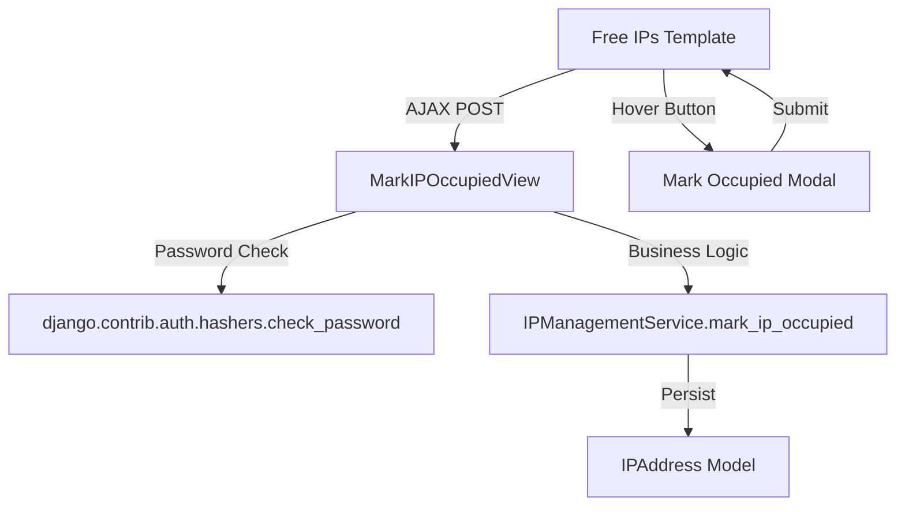

# Design Document: Mark IP as Occupied

## Overview

This feature adds a "Mark as Occupied" action to the Free IPs page, allowing admins to flag IPs detected as in-use (e.g., via network scan) without linking them to a specific asset or guest. It follows the same AJAX + modal pattern used by the existing "Assign Guest IP" feature but introduces a password verification step and new model fields to distinguish manually-occupied IPs from other assignment types.

The implementation requires:
1. New model fields on `IPAddress` to store manual-occupation metadata
2. A new service method `mark_ip_occupied()` in `IPManagementService`
3. A new AJAX view endpoint at `POST /assets/ip/mark-occupied/`
4. A hover button on free IP items and a password-confirmation modal in the template
5. Visual styling for manually-occupied IPs (red background + label)

## Architecture

The feature follows the existing layered architecture:



**Request Flow:**
1. Admin hovers over a free IP item → "Mark as Occupied" button appears
2. Admin clicks button → Password modal opens (pre-filled with IP address)
3. Admin enters password and submits → AJAX POST to `/assets/ip/mark-occupied/`
4. View verifies password via `check_password(password, request.user.password)`
5. View calls `IPManagementService.mark_ip_occupied(ip_address, request.user)`
6. Service sets `is_assigned=True`, `manually_occupied=True`, `occupied_by`, `occupied_date`
7. View returns JSON success → JS updates the IP item styling in-place

## Components and Interfaces

### 1. IPAddress Model (Modified)

New fields added to `assets/models/ip_address.py`:

```python
# Manual occupation fields
manually_occupied = models.BooleanField(
    default=False,
    help_text="Whether this IP was manually marked as occupied"
)
occupied_by = models.CharField(
    max_length=150,
    blank=True,
    null=True,
    help_text="Username of admin who marked this IP as occupied"
)
occupied_date = models.DateTimeField(
    blank=True,
    null=True,
    help_text="When this IP was manually marked as occupied"
)
```

### 2. IPManagementService (Extended)

New method in `assets/services/ip_management_service.py`:

```python
@staticmethod
def mark_ip_occupied(ip_address, admin_user):
    """
    Mark a free IP address as manually occupied.
    
    Args:
        ip_address: IPAddress instance
        admin_user: User instance performing the action
    
    Raises:
        ValidationError: If IP is already assigned
    """
```

**Behavior:** Uses `transaction.atomic()`, refreshes from DB, validates IP is free, then sets `is_assigned=True`, `manually_occupied=True`, `occupied_by=admin_user.username`, `occupied_date=timezone.now()`.

Pattern mirrors `assign_ip_to_guest()` exactly.

### 3. MarkIPOccupiedView (New)

New view in `assets/views.py`:

```python
class MarkIPOccupiedView(AdminRequiredMixin, View):
    """Handle AJAX request to mark IP as occupied."""
    
    def post(self, request):
        # 1. Extract ip_address and password from POST
        # 2. Validate inputs present
        # 3. Verify password with check_password()
        # 4. Look up IPAddress by address string
        # 5. Call IPManagementService.mark_ip_occupied()
        # 6. Return JsonResponse with success/error
```

**Endpoint:** `POST /assets/ip/mark-occupied/`  
**Request body:** `ip_address` (string), `password` (string)  
**Responses:**
- 200: `{"success": true, "message": "...", "ip_address": "...", "occupied_by": "..."}`
- 400: `{"success": false, "error": "..."}` (validation error or already assigned)
- 403: `{"success": false, "error": "Incorrect password."}` (wrong password)
- 404: `{"success": false, "error": "IP address not found."}` (no such IP)

### 4. URL Configuration

New entry in `assets/urls.py`:

```python
path('ip/mark-occupied/', MarkIPOccupiedView.as_view(), name='mark_ip_occupied'),
```

### 5. Template Changes (free_ips.html)

**Hover button:** Added inside the `.ip-item` div for free IPs:
```html

    <button class="mark-occupied-btn" 
            data-ip-address="{{ ip.address }}">Mark Occupied</button>

```

**Modal:** A new `markOccupiedModal` with password input and IP address display, following the same structure as `guestAssignmentModal`.

**JavaScript:** AJAX handler that:
1. Opens modal on button click, pre-fills IP address
2. On submit, sends POST to ``
3. On success, updates the IP item's class from `free` to `occupied` and adds label text
4. On error, displays error message in the modal

**CSS:** The `.mark-occupied-btn` uses the same hover-reveal pattern as `.release-guest-btn`.

### 6. Occupant Type Integration

The existing `get_ip_occupant_info()` method in `IPManagementService` determines occupant type for display. For manually-occupied IPs, this needs to return a distinct type or be handled in the view's display logic. Since the template already checks `ip.occupant_type`, the view that prepares IP data (likely annotating `occupant_type` on each IP) must set `occupant_type = 'occupied'` when `manually_occupied=True`. The existing template already has an `occupied` class and styling path for the else-branch (not free, not guest, not vm).

## Data Models

### IPAddress Model Changes

| Field | Type | Default | Description |
|-------|------|---------|-------------|
| `manually_occupied` | BooleanField | False | Flag distinguishing manual occupation from asset/guest assignment |
| `occupied_by` | CharField(150) | null | Username of admin who marked it |
| `occupied_date` | DateTimeField | null | Timestamp of when it was marked |

**Migration:** A single migration adds three nullable fields with defaults. No data migration needed since all existing IPs will default to `manually_occupied=False`.

### State Transitions

An IP can be in one of these states:
- **Free:** `is_assigned=False`, `manually_occupied=False`, no `guest_name`, no `assigned_to_asset`
- **Asset-assigned:** `is_assigned=True`, `assigned_to_asset` set
- **Guest-assigned:** `is_assigned=True`, `guest_name` set
- **Manually occupied:** `is_assigned=True`, `manually_occupied=True`, `occupied_by` set

The `mark_ip_occupied` service method only transitions Free → Manually occupied.

## Correctness Properties

*A property is a characteristic or behavior that should hold true across all valid executions of a system — essentially, a formal statement about what the system should do. Properties serve as the bridge between human-readable specifications and machine-verifiable correctness guarantees.*

### Property 1: Marking an occupied IP removes it from free list

*For any* free IP address, after calling `mark_ip_occupied`, the IP SHALL have `is_assigned=True` and `manually_occupied=True`, making it no longer appear in the free IPs query (`IPAddress.objects.filter(is_assigned=False)`).

**Validates: Requirements 3.1, 3.2**

### Property 2: Already-assigned IPs cannot be marked occupied

*For any* IP address that is already assigned (`is_assigned=True`), calling `mark_ip_occupied` SHALL raise a `ValidationError` and leave the IP unchanged.

**Validates: Requirements 3.5, 5.6**

### Property 3: Manual occupation records admin and timestamp

*For any* successful `mark_ip_occupied` call, the resulting IP SHALL have `occupied_by` equal to the admin's username and `occupied_date` within the time window of the call.

**Validates: Requirements 3.3, 3.4**

### Property 4: Password verification gates the action

*For any* request to the mark-occupied endpoint with an incorrect password, the system SHALL return HTTP 403 and the IP SHALL remain unchanged (still free).

**Validates: Requirements 2.3, 2.4, 5.4**

### Property 5: Round-trip consistency of manual occupation state

*For any* IP marked as manually occupied, querying the IP and checking `manually_occupied`, `occupied_by`, and `occupied_date` SHALL return the values that were set during the mark operation (serialization round-trip through the database).

**Validates: Requirements 4.2, 4.3, 4.4**

## Error Handling

| Scenario | HTTP Status | Error Message | Behavior |
|----------|-------------|---------------|----------|
| Missing IP address in request | 400 | "IP address is required." | No state change |
| Missing password in request | 400 | "Password is required." | No state change |
| Incorrect password | 403 | "Incorrect password." | No state change |
| IP address not found in DB | 404 | "IP address {addr} not found." | No state change |
| IP already assigned | 400 | "This IP address is already assigned." | No state change, ValidationError from service |
| Unexpected server error | 500 | "Error marking IP: {details}" | Logged via logger.exception() |

All errors return `{"success": false, "error": "..."}` JSON. The frontend JS displays the error message in the modal's error div.

## Testing Strategy

### Unit Tests (Example-based)

- Test `mark_ip_occupied` service method: success case, already-assigned rejection, manual IP conflict detection
- Test `MarkIPOccupiedView`: correct password → success, wrong password → 403, missing IP → 404, missing fields → 400
- Test model fields: verify defaults, nullable behavior
- Test that the hover button only renders for `occupant_type == 'free'` items

### Property-Based Tests (Hypothesis)

Using the `hypothesis` library (already in use in this project based on `.hypothesis/` directory):

- **Property 1:** For any randomly generated free IP and admin user, `mark_ip_occupied` sets `is_assigned=True` and `manually_occupied=True`
- **Property 2:** For any randomly generated already-assigned IP, `mark_ip_occupied` raises `ValidationError`
- **Property 3:** For any successful mark operation, `occupied_by == admin_user.username` and `occupied_date` is within the execution window
- **Property 4:** For any request with an incorrect password string, the endpoint returns 403 and IP state is unchanged
- **Property 5:** For any marked IP, reading back from DB returns consistent `manually_occupied`, `occupied_by`, `occupied_date` values

Each property test runs a minimum of 100 iterations.
Tag format: **Feature: mark-ip-occupied, Property {N}: {title}**

### Integration Tests

- End-to-end test: login as admin → POST to endpoint → verify DB state → verify page renders updated styling
- Test CSRF protection is enforced on the endpoint
